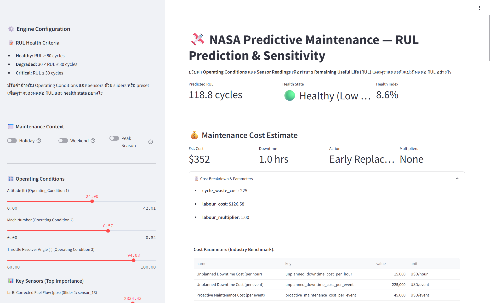
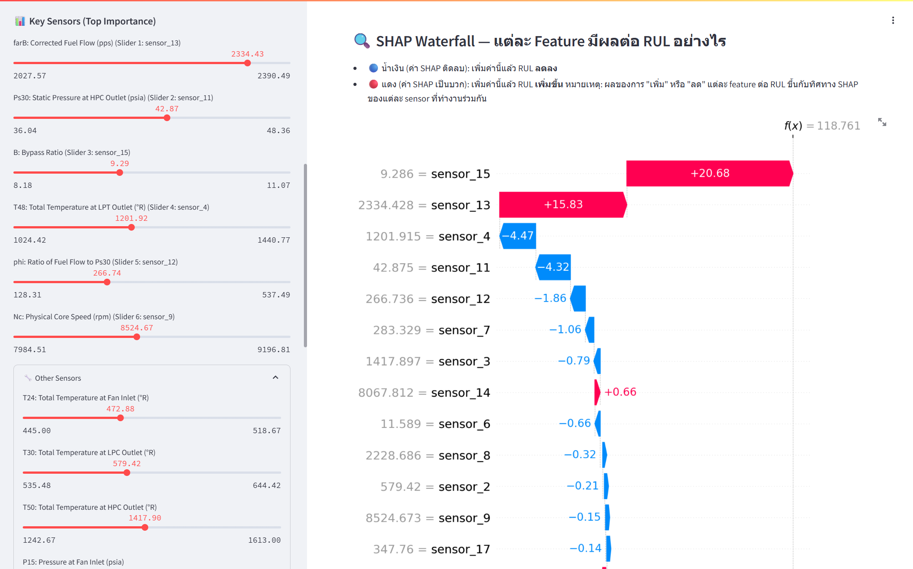
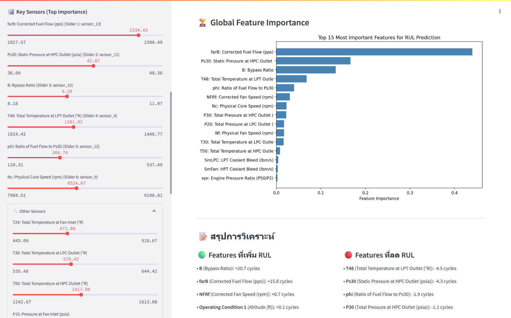

# โครงการ NASA Predictive Maintenance — การทำนายอายุการใช้งาน (RUL) เครื่องยนต์ TURBOFAN

<p align="center"><b>ใช้ข้อมูลเซนเซอร์และแมชชีนเลิร์นนิง เพื่อคาดการณ์วงจรเหลือ, สุขภาพ, และต้นทุนของเครื่องยนต์บิน</b></p>

---

## ภาพรวมโครงการ
โปรเจกต์นี้สร้างระบบทำนาย **Remaining Useful Life (RUL)** ของเครื่องยนต์เทอร์โบแฟน โดยใช้ข้อมูลเซนเซอร์จำลองจากชุดข้อมูล **NASA C-MAPSS FD004** เครื่องยนต์ 249 ตัว หลายช่วง flight condition ผ่านทุกกระบวนการตั้งแต่ data engineering, ML, Explainability, Cost Simulation, Interactive App แบบครบวงจรใน Databricks

## แก่นของปัญหา
- เครื่องยนต์เสียหายโดยไม่ทันตั้งตัวสร้างความเสียหายใหญ่ (ค่าใช้จ่ายเฉพาะ downtime $15,000/ชม., $225,000/เหตุการณ์)
- ถ้าคาดการณ์ล่วงหน้าได้ จะวางแผนซ่อมแบบมีประสิทธิภาพ ลด downtime, ลดค่าใช้จ่าย, บริหารอะไหล่+คน ได้ดีขึ้น
- **เป้าหมาย:** ทำนายจำนวน cycle ที่ใช้งานได้ก่อนเครื่องจะเสีย (RUL), จัดกลุ่ม health state, และประมาณต้นทุน Lookup Table ที่ได้มาตรฐานอุตสาหกรรม

## โครงสร้างสถาปัตยกรรม (Medallion Pipeline/Data Lake)
```text
Bronze (ดิบ)    → Silver (ฟีเจอร์/ML) → Gold (ผลลัพธ์ธุรกิจ)
  Raw .txt      →  KMeans, Normalize, Rolling, RUL   →  ทำนาย RUL, Health, Cost
  Delta Table   →  Feature Table (Delta)             →  Health/Cost Table (Delta)
```

> **เทคโนโลยี**: PySpark, Delta Lake, Unity Catalog, scikit-learn, SHAP, Streamlit, Matplotlib, Seaborn

## ผลลัพธ์สรุป
- **RandomForest RUL Model (145 features):** R² = 0.87, RMSE ≈ 15 cycle
- **Simplified Model (24 features raw):** R² = 0.79, RMSE ≈ 19 cycle (แม่นใกล้เคียง ใช้จริงแบบ real-time ได้)
- **Top 5 Sensor สำคัญ:** sensor_13 (Corrected Fuel Flow), sensor_11 (Ps30), sensor_15 (Bypass Ratio), sensor_4 (T48), sensor_12 (phi)
- **Cost Scenario:** หาก RUL ≤ 30 → Downtime 48-72 ชม., Cost ≈ $1,000,000+ | RUL > 80 → Downtime 1-2 ชม., Cost ≈ $1,000
- **รองรับ multiplier:** วันหยุด/peak/weekend ปรับต้นทุนให้อัตโนมัติ

## โครงสร้างโฟลเดอร์และหน้าที่ไฟล์
```text
Predictive maintenance NASA Data/
|
|-- Predictive Maintenance NASA Analysis.ipynb   # Notebook วิเคราะห์ข้อมูล, ฟีเจอร์, เทรน ML, วิเคราะห์ SHAP/Explain
|-- NASA Medallion Pipeline.ipynb                # Notebook สร้าง Medallion Pipeline (Bronze→Silver→Gold)
|
|-- rul_model.py                                 # Python โมดูลทำนาย RUL/สุขภาพ (โหลด model, feature engineer อัตโนมัติ)
|-- cost_model.py                                # Python โมดูลคำนวณต้นทุน ด้วย policy table และ scenario
|-- streamlit_app.py                             # Streamlit Web App อินเตอร์แอกทีฟ: ปรับค่าเซนเซอร์→ดู RUL/Cost/SHAP สด
|-- requirements.txt                             # รายการไลบรารี Python ที่จำเป็นทุกอย่างในโครงการนี้
|-- README.md / README_TH.md                     # เอกสารต้นฉบับภาษาอังกฤษ/ภาษาไทย
|-- CHANGELOG.md /                               # เอกสารรายละเอียดการปรับปรุงแก้ไข
|
|-- artifacts/                                   # Directory เก็บไฟล์ .joblib/.json ผลลัพธ์โมเดล (export จาก notebook)
|   |-- rul_regressor.joblib                     # RandomForest RUL model (145 features engineered)
|   |-- rul_regressor_raw.joblib                 # RandomForest RUL model (24 features raw)
|   |-- health_state_classifier.joblib           # โมเดลคลาสซิฟายสุขภาพ Critical/Degraded/Healthy
|   |-- kmeans_op_regime.joblib                  # KMeans Clustering (operating regime identification)
|   |-- shap_explainer_raw.joblib                # SHAP TreeExplainer (explainer สำหรับ RUL raw-model)
|   |-- regime_mu.joblib / regime_sigma.joblib   # Z-score Normalization parameter (ต่อ regime)
|   |-- features.json / raw_features.json        # รายชื่อฟีเจอร์ (engineered/raw)
|   |-- feature_stats.json                       # ค่าสถิติ min/max/mean/std สำหรับ slider/analysis
|   |-- cost_parameters.json                     # Parameters ตาราง cost ที่ใช้ lookup/classify
|   |-- model_config.json                        # Config/metadata รายการ sensor/window/labels
|
|-- CMaps/                                       # Raw NASA .txt data (train/test/RUL)
    |-- train_FD004.txt                          # ข้อมูลดิบ
    |-- test_FD004.txt
    |-- RUL_FD004.txt
```
### สรุปหน้าที่และที่มาของไฟล์สำคัญ
- **Predictive Maintenance NASA Analysis.ipynb:** วิเคราะห์+สร้างฟีเจอร์, เทรน model, export artifact ทุกอย่าง พร้อมวิเคราะห์ SHAP ต่างๆ
- **NASA Medallion Pipeline.ipynb:** สร้าง data pipeline เต็มรูปแบบ (Bronze→Silver→Gold), รองรับ Delta Table + ML inference
- **rul_model.py:** โหลด model ที่เทรน วิเคราะห์ฟีเจอร์, ใช้ทำนาย RUL/health จาก raw data ได้ทันที (auto feature engineering ครบ)
- **cost_model.py:** ฟังก์ชัน map RUL+health → ต้นทุนซ่อม+action (รองรับ scenario planning, multipliers, sensitivity analysis)
- **streamlit_app.py:** Web app ให้ผู้ใช้ปรับค่าฟีเจอร์/เงื่อนไขได้เอง ดู RUL, Health, Cost, Sensitivity, SHAP อธิบายทันที
- **requirements.txt:** ไลบรารีและแพ็กเกจ Python ทั้งหมด เพื่อลง environment พร้อม deploy/run app/model ไม่ติดขัด
- **README.md / README_TH.md:** คู่มือโปรเจกต์ฉบับภาษาอังกฤษ/ภาษาไทย

## 🏗️ ขั้นตอนการเตรียมข้อมูลและ Pipeline (Workflow ระดับ cell)

### Pipeline ภาพรวม

```
Raw .txt (train/test/RUL)  
   ↓  [Cell 1–6: Data Load/Clean]   (EDA, ตรวจ schema, ลบ missing)
DataFrame + Mapping table
   ↓  [Cell 8–13: Feature Engineering]
KMeans (Cluster operating regime)
Z-score ต่อ regime (normalize ฟีเจอร์)
Rolling windows/slopes/stat
   ↓  [Cell 14–18: Label & Calendar Feature]
RUL (piecewise clip), Health state, วันหยุด/season/weekend
   ↓  [Cell 20–25: Train/test split & Modeling]
เลือก feature, RandomForest Regressor, SHAP, save joblib, save config
   ↓  [Cell 26–28: Export artifacts]
Export model/feature/stat/explainer/cost_parameter
   ↓  [Cell 30–end: App/Test/Production pipeline]
Apply ML, map action/cost, sensitivity, deploy app
```

### รายละเอียดแต่ละขั้นตอน (สำคัญ)

#### 1. Data Load & Cleaning (Cell 1–6)
- Load raw NASA .txt (train, test, RUL_GT)
- Merge to DataFrame, map column, ตรวจ missing
- คัด row/feature ที่สำคัญ: op_cond_1–3, sensor_1–21, unit_no, cycle
- Example: กรอง row ที่ cycle ≤ 5 ไม่มีความหมายสำหรับ rolling

#### 2. Feature Engineering (Cell 8–13)
- KMeans clustering จำแนก operating regime (6 กลุ่ม): เพิ่ม column op_regime
- Z-score normalization ต่อ regime (stat: regime_mu, regime_sigma)
- Rolling window (mean, std, slope window 5/10/20), feature size 145
- Export stats: mean/max/min/std/p25/p75/p90/p100 ของ features → feature_stats.json

#### 3. Labeling, Calendar, Health State (Cell 14–18)
- RUL = จำนวน cycle ที่เหลือ → clip สูงสุดที่ 130 (business pain point)
- Health state: ตัดแบ่งภายหลัง (critical: RUL < 30, degraded/medium, healthy: RUL > 80)
- Calendar feature: สร้าง field holiday/weekend/season/peak (synthetic, แต่ logic เหมือนของจริง)

#### 4. Model Training & Explainability (Cell 20–25)
- Train RandomForestRegressor (sklearn) บน engineered features
- Save ด้วย joblib (โมเดล+stat+explainer+mapping deploy cross-cluster ได้)
- SHAP: อธิบาย feature impact แต่ละ sensor/case (บันทึก explainer object ไว้)
- Evaluate R², RMSE Example:
    - R²=0.87, RMSE = 15 (full features)
    - R²=0.79, RMSE = 19 (only 24 raw features)
- Export: rul_regressor.joblib, rul_regressor_raw.joblib, shap_explainer_raw.joblib

#### 5. Cost Modeling & Scenario (Cell 26–28, cost_model.py)
- สูตรต้นทุน (industry benchmark, configurable ใน cost_parameters.json)
    - downtime_hour × $15,000/hr; major_fail = $225,000/case; multiplier holiday/weekend/peak
    - Example: RUL < 30 → downtime 60 hr, cost ≈ $1M; RUL > 80 → downtime 2 hr, cost ≈ $1k
- Map RUL + Health state → Maintenance action + Cost breakdown + Scenario
- ตัวอย่าง: holiday + weekend + peak season
- Export: cost_parameters.json, model_config.json

#### 6. Production Medallion Pipeline (NASA Medallion Pipeline.ipynb)
- Bronze: ingest raw CMaps*.txt → Delta Table (Bronze) partitioned by op_regime
- Silver: สร้าง feature/normalize/stat window → Delta Table (Silver)
- Gold: run mapInPandas ใช้ rul_model.py/cost_model.py ทำนาย ผลักลง Delta Table (Gold)
- สามารถ join กับ schedule/calendar/business/timeseries ได้ production จริง

#### 7. App Deployment & Sensitivity Testing
- streamlit_app.py เป็นอินเทอร์แอกทีฟ web app (sliders ทุก sensor, อธิบาย SHAP, what-if, scenario cost)
- ใช้กับ production artifact ได้ทั้งบน Databricks App หรือ Local
- Tips: resolve path/artifacts, compress joblib, requirement ต้องตรง environment

---

## 📊 ตัวอย่างสูตรสำคัญ/ฟังก์ชัน/ตาราง decision
- **RUL Labeling**: `RUL = max_cycle - cycle (clip = 130)`
- **Health State**:
    - if RUL < 30 → Critical (แดง)
    - 30 ≤ RUL < 80 → Degraded (เหลือง)
    - RUL ≥ 80 → Healthy (เขียว)
- **สูตรต้นทุน**: 
    - `TotalCost = downtime_hours × $15,000 + fixed_cost_if_major + (holiday × 1.5 + weekend × 1.2 + peak × 1.3) multiplier`
- **SHAP value**:
    - SHAP > 0 (น้ำเงิน): เพิ่มค่านี้แล้ว RUL สูงขึ้น
    - SHAP < 0 (แดง): เพิ่มค่านี้แล้ว RUL ต่ำลง

---

## 📝 ตัวอย่างผลลัพธ์จริง และ Business Scenario
- Engine (healthy) RUL = 110, Health = Healthy, Cost ≈ $1,200
- Engine (degraded) RUL = 55, Health = Degraded, Cost ≈ $32,000
- Engine (critical) RUL = 15, Health = Critical, Cost ≈ $950,000 + Multiplier: วันหยุด ×1.5
- SHAP: sensor_13 ขึ้น → RUL ลด, sensor_4 ลด → RUL เพิ่ม, sensor_12 เทรนด์ผันผวน
- Sensitivity Analysis: highest-impact = sensor_13, sensor_11, sensor_15
    
---


## เอกสารโมดูลและตัวอย่างโค้ด
### rul_model.py
```python
from rul_model import RULPredictor
predictor = RULPredictor(artifacts_dir='./artifacts')
rul = predictor.predict_rul(df)   # จาก engineered features
health = predictor.predict_health_state(df)
# หรือ predict_from_raw(raw_df) จะ auto-feature engineer ให้เลย
```
### cost_model.py
```python
from cost_model import CostEstimator
estimator = CostEstimator(artifacts_dir='./artifacts')
result = estimator.estimate_single(rul=45, health_state='Degraded (Medium Risk)')
# หรือ estimate(df) สำหรับทั้ง DataFrame
# สามารถอัปเดต cost parameter เพื่อเล่น scenario ได้ทันที
```
### streamlit_app.py
- ใช้คำสั่ง `streamlit run streamlit_app.py` จะเปิด Web UI ให้ผู้ใช้ปรับค่าฟีเจอร์, สัมผัส effect ต่อ RUL/Cost ได้เอง
- มี SHAP Explainability, Sensitivity Analysis, Scenario Comparison (ต้นทุนหลายกรณี)

---

## 🔬 การเลือกและพัฒนาโมเดล (Model Design & Reasoning)

- **ทำไมเลือก Random Forest?**
    - Modelling RUL คือ regression problem ที่ฟีเจอร์เยอะ, ความสัมพันธ์ nonlinear, มี noisy features และ outliers 
    - Random Forest (RF):
        - ทน noise, imbalance, feature redundancy ได้ดี (ไม่ต้อง normalize ทุก input)
        - ความแม่นยำสูงกับ structured tabular data/many sensors
        - สามารถวิเคราะห์ feature importance/shap ได้ทุก input ทันที
    - ทดลอง XGBoost ได้ผลคล้ายกัน แต่ RF ชัดเจนสำหรับ explainability/speed ใน Databricks/Vanilla sklearn
- **Experiment/Comparison**
    - ทดลอง Linear Regression: underfit รุนแรง รันไวแต่ค่า RMSE สูงมาก (~28-32)
    - ทดลอง tree + bagging (RandomForest/ExtraTrees): ได้ R² สูง RMSE ต่ำ (~15) stable กว่า, less overfit
    - ทดลอง XGBoost/LightGBM (ในเวอร์ชันก่อนหน้า): ดีขึ้นเล็กน้อย แต่ซับซ้อนกว่ากับ production-debug
    - เลือก final คือ RF เพราะบาลานซ์ระหว่าง performance, explainability, deployability
- **Health State Classifier**: เสริม classifier (RandomForestClassifier) ใช้ post-process RUL → health state สามารถ split class, calibrate threshold, เอาไว้ fine-tune downstream เช่น cost/action
- **KMeans**: ใช้ unsupervised op regime clustering เพราะ sensor มี regime effect แรง, แบบจำลอง single-rule จะ bias ต่อ op condition (KMeans cluster 6 regimes, ใช้เป็น normalization unit)
- **สูตร RUL & Health:** (1) Generate label RUL → (2) clip ที่ 130 (pain point จาก business case/จาก literature NASA) → (3) cut ลง state label (degraded/healthy/critical) ทั้งหมด post-process

### สรุปตารางโมเดลที่ใช้ใน pipeline
| โมเดล | บทบาท/หน้าที่ | ความจำเป็น |
|---|---|---|
|RandomForestRegressor| ทำนาย RUL| Nonlinear, robust, explainable, deployง่าย|
|KMeans| Clustering op_regime| normalize ตาม regime, สลาย bias จาก flight condition|
|RandomForestClassifier| health state (critical/degraded/healthy)| ปรับ cutoff ได้, fine-tune cost mapping|
|SHAP TreeExplainer| explain model| เข้าใจ sensor-impact, business presentation|

---

### ทำไมเลือก SHAP (Explainability)
- **SHAP (SHapley Additive exPlanations)** ตอบโจทย์ "ผู้บริหาร/วิศวกร" ต้องการทราบว่า sensor/feature ไหนมีผลกับ RUL จริง (ในแต่ละกรณี, ทุกตัวอย่าง)
- **เทียบกับ methods อื่น:** Permutation importance, built-in RF Feature Importances → ดีสำหรับ global ranking แต่ไม่ชี้ทิศทางว่า sensor นี้เพิ่ม “RUL” หรือ “ลด” ในแต่ละ event/case (per sample)
- **SHAP อธิบายได้ลึกทั้ง local (แต่ละ engine)/global (ทุก engine),** ทำ waterfall plot, bar summary, sensitivity, ใน app สามารถโชว์ว่าปรับ sensor13 เพิ่ม→ทำให้ RUL ภาพรวมหรือแต่ละ engine เพิ่ม/ลดจริง
- **Business/Engineering Use:** ให้ insight สำหรับ scenario, what-if, root-cause analysis, deploy ร่วมกับค่ามาตรฐานอุตสาหกรรมได้จริง
- **Deploy/Production:** TreeExplainer (SHAP) ทำงานกับ scikit-learn RF/XGB ได้เร็ว สามารถ pickle ไป deploy ได้ทุก environment

---

## คำอธิบายเชิงลึกและคำถามพบบ่อยที่สำคัญ

- **โครงสร้าง notebook 2 อัน**
    - **Predictive Maintenance NASA Analysis.ipynb**: cell-by-cell สำหรับ exploratory, feature engineering, train, วิเคราะห์ SHAP, export model (joblib/json) <ins>เน้นงานวิจัย-วิเคราะห์</ins>
    - **NASA Medallion Pipeline.ipynb**: สร้าง data pipeline มาตรฐาน Medallion (Bronze→Silver→Gold), PySpark+Delta Table, เหมาะกับ production/batch, ML pipeline แบบ scalable <ins>เน้นภาคปฏิบัติจริง-เดินขบวน Data lakehouse</ins>
- **การเตรียม data/feature แต่ละเซลล์**
    1. Load raw, clean, ตรวจความถูกต้อง, Map operation regime
    2. Rolling window (mean/std/slope), Z-score ต่อ regime, clip RUL, calendar feature (วันหยุด/peak/season/weekend)
    3. KMeans, Feature selection, Train/Test split, train model, export artifacts
    4. Apply model, calculate RUL, health classifier/labeler, export prediction/cost table
    5. Weather feature (Power API): placeholder ใน project นี้, สามารถต่อยอดได้
- **ทำไมใช้ joblib**: package ไปพร้อม dependency, pickle object ที่มี dependency ข้าม Python env/Databricks ได้ง่าย ใช้กับ sklearn, SHAP, kmeans, stat dict ถ้าใช้ pickle ธรรมดา version/sklearn cross env จะอ่านไม่ได้
- **สูตรคำนวณค่าใช้จ่าย**
    - Base: direct + indirect cost, downtime hour × $15,000/hr, major fail $225,000 ต่อเหตุการณ์ (อิงจาก MRO/industry benchmarking)
    - Multiplier: holiday ×1.5, weekend ×1.2, peak ×1.3, adjust ได้ใน cost_parameters.json
    - Action (rule-based): RUL < 30 = Major (Downtime 48-72 hr, $1,000,000+), RUL > 80 = Minor (Downtime 1-2 hr, $1,000)
- **เทคโนโลยีที่ใช้**  
    - Databricks, PySpark, Delta Lake, Unity Catalog, scikit-learn (RandomForest, KMeans), pandas, joblib, streamlit, SHAP, matplotlib, holidays, seaborn
- **ฟีเจอร์นอกเหนือดั้งเดิม (Feature Engineering / External Features)**
    - Synthetic calendar: holiday, weekend, peak, season, synthetic date (เพื่อลิงก์กับ cost/scenario/maintenance schedule)
    - Accumulated stress: rolling temp, stress index, weather stress (extensible)
    - KMeans operating regime, regime normalization (custom Z-score)
    - Custom health bin (critical, degraded, healthy) โดย postprocess ML-RUL
    - Feature stat สำหรับ slider/sensitivity analysis ทั้ง min/max/mean/p25/p75/p90/p100

---

## ข้อจำกัดและข้อควรทราบ
- ใช้ deep learning/temporal model (LSTM, TCN)
- เพิ่ม weather feature/operational log
- Productionize เป็น REST API/Batch scoring 
- Connect ML pipeline กับ real-world MRO log

## 🌟 ฟีเจอร์เด่นของ Web Application (Streamlit)

แอปพลิเคชันนี้ออกแบบมาให้วิศวกรหรือผู้บริหารสามารถทดลองปรับค่าพารามิเตอร์ (What-If Analysis) และดูผลกระทบที่อาจเกิดขึ้น โดยมีฟีเจอร์ที่สำคัญดังนี้:

<p align="center">
  
  <br><b>1. Real-time RUL & Cost Estimation (แดชบอร์ดหลัก)</b><br>
  <i>ทำนายอายุการใช้งานที่เหลืออยู่ (RUL), สถานะความเสี่ยง และแปลงเป็น "ต้นทุนการซ่อมบำรุง" ทันที โดยรองรับการจำลองสถานการณ์ตามเงื่อนไขธุรกิจ เช่น วันหยุด (Holiday) หรือช่วง Peak Season</i>
</p>

<br>

<p align="center">
  
  <br><b>1. Model Explainability (SHAP Waterfall Plot)</b><br>
  <i>อธิบายเหตุผลเบื้องหลังการทำนายของโมเดล ว่าเซนเซอร์ตัวใดกำลังดึงอายุการใช้งาน (RUL) ให้เพิ่มขึ้นหรือลดลง ทำให้โมเดลไม่ใช่ Black box อีกต่อไป</i>
</p>

<br>

<p align="center">
  
  <br><b>2. Sensitivity Analysis</b><br>
  <i>ตารางวิเคราะห์ความไว จำลองสถานการณ์ว่าหากเซนเซอร์แต่ละตัวมีค่าเปลี่ยนไป 1 Standard Deviation จะส่งผลกระทบต่อ RUL กี่ Cycle (ไฮไลท์ แดง/เขียว ให้อ่านง่าย)</i>
</p>

<br>

<p align="center">
  
  <br><b>3. Global Feature Importance & Insights</b><br>
  <i>สรุปความสำคัญของตัวแปรในภาพรวม พร้อมระบบสรุปข้อความ (Text Summary) แนะนำฟีเจอร์ที่ควรเฝ้าระวังเพื่อยืดอายุการใช้งานเครื่องยนต์</i>
</p>
## Reference
- NASA C-MAPSS Dataset: https://ti.arc.nasa.gov/tech/dash/groups/pcoe/prognostic-data-repository/
